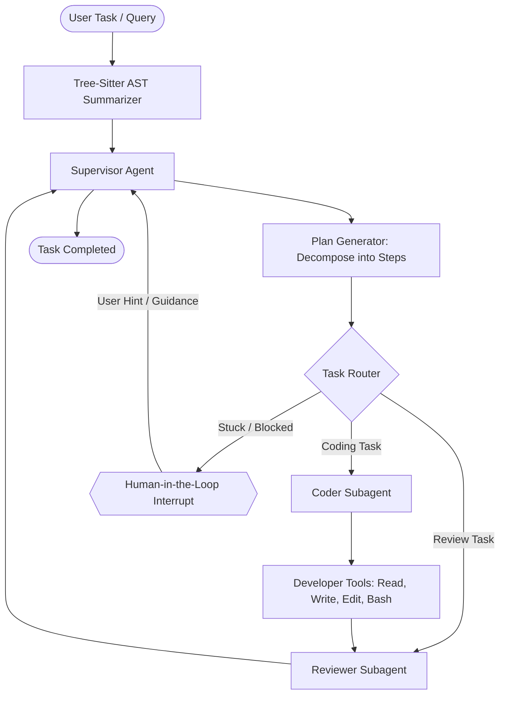

# Multi-Agent Coding Assistant

An autonomous multi-agent software engineering assistant built with **LangGraph**, **LangChain**, and **Tree-sitter AST parsing**.

The assistant orchestrates specialized subagents (Supervisor, Coder, Reviewer), extracts syntax trees across multiple languages to build precise codebase summaries, executes file modifications, and features Human-in-the-Loop (HITL) intervention when human guidance is needed.

---

## Architecture



---

## Key Highlights

- **Multi-Agent Coordination:** A Supervisor agent drives planning and step-by-step delegation between a `Coder` subagent (for file writing, editing, and execution) and a `Reviewer` subagent (for validation and code inspection).
- **Multi-Language AST Codebase Summarization:** Uses Tree-sitter parsers (`tree-sitter-python`, `tree-sitter-javascript`, `tree-sitter-typescript`, `tree-sitter-cpp`) to extract classes, functions, and imports directly from the AST, delivering concise, hallucination-free repository context to the LLM.
- **Developer Toolset:**
  - `read_file`, `write_file`, `edit_file`
  - Safe subprocess execution for tests and terminal commands
- **Human-in-the-Loop (HITL) Interruption:** When the agent detects an impasse or ambiguous requirements, it triggers an interrupt, prompts the user for clarification, and resumes execution seamlessly.
- **Persistent State:** Uses thread-based state tracking saved to `test_results/threads.json`.

---

## Installation & Setup

### 1. Prerequisites
Requires Python >= 3.13. Install dependencies using `uv` (recommended) or `pip`:

```bash
git clone https://github.com/eyyub679/coding_assistant.git
cd coding_assistant
uv sync
```

### 2. Configure Environment
Copy `.env.example` to `.env`:

```bash
cp .env.example .env
```

Set your API credentials:
```ini
GOOGLE_API_KEY="your-google-gemini-api-key"

# Optional (for NVIDIA Nemotron inference)
NVIDIA_API_KEY="your-nvidia-api-key"
```

### 3. Usage

Run the assistant CLI:
```bash
python -m coding_assistant.main
```
Or if installed as a package:
```bash
run-agent
```
Enter a coding instruction (e.g. `Refactor the error handling in api.py and add unit tests`) and watch the supervisor, AST analyzer, and subagents collaborate.
